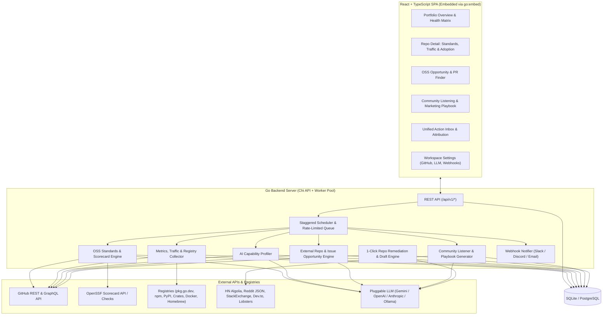

# OSSAlot — Architecture & Implementation Plan

**OSSAlot** is a SaaS-ready platform for monitoring open source repository health, tracking adoption and traffic history, auditing & remediating OSS standards, discovering external open source projects/issues that genuinely need your project, and executing non-spammy community marketing across Reddit, Hacker News, Stack Overflow, Dev.to, and Lobsters.

---

## 1. Core Architectural Decisions (Resolved in Design Interview)

| Area | Decision | Rationale |
| :--- | :--- | :--- |
| **Backend** | **Go 1.22+** (`chi` router, structured `slog`, built-in scheduler & rate-limited worker pool) | Fast concurrency for multi-repo polling, native ecosystem alignment with GitHub APIs & OpenSSF Scorecard, compiles to a single binary. |
| **Frontend** | **React 18 + TypeScript + Vite + Tailwind CSS + shadcn/ui + Lucide + Recharts** embedded via `go:embed` | Rich interactive time-series charts, scorecard matrices, and unified Opportunity Inbox while preserving 1-binary local deployment. |
| **Database** | **SQLite (WAL mode)** by default (`modernc.org/sqlite`, zero-CGO), schema compatible with **PostgreSQL** | Instant zero-config local setup for 1-user/many-repos with clean SQL migrations ready for multi-tenant SaaS. |
| **Tenancy & Auth** | **Tenant-aware schema** (`workspaces`, `users`) with auto-bootstrapped `default` personal workspace locally | Zero login friction in personal mode; toggleable GitHub OAuth / session middleware for hosted SaaS mode. |
| **Git Integration** | **GitHub REST v3 + GraphQL v4** (PAT or OAuth token per workspace) | Auto-discovers all owned/starred/org public repos, tracks arbitrary public GitHub URLs, reads 14-day traffic endpoints, and opens remediation PRs on owned repos. |
| **OSS Standards Audit** | **Multi-category scorecard + AI fix generator** | Evaluates Community Files (`README`, `LICENSE`, `CONTRIBUTING`, `CODE_OF_CONDUCT`, `SECURITY`, Issue/PR templates), Technical Hygiene (CI/CD workflows, releases/changelog, badges, semver), and Security/OpenSSF Scorecard metrics — with 1-click file/PR generation on owned repos. |
| **Health & Adoption Metrics** | **Full time-series tracking** | GitHub engagement (stars, forks, watchers, issue/PR velocity, contributor retention), GitHub 14-day traffic snapshots (clones, views, referrers persisted long-term), GitHub Dependents/network graph, and Package Registry downloads (npm, PyPI, Crates.io, Docker/GHCR, Homebrew, Go module proxy/pkg.go.dev). |
| **OSS Opportunity Finder** | **AI-driven Capability Profile + GitHub Search pipeline** | Extracts a "Problem/Capability Profile" from the repo, searches GitHub Issues/Discussions/Code across active repos, scores & filters matches using an LLM for genuine high-value fit, and generates a tailored PR implementation plan or draft response (human-reviewed before posting). |
| **Community & Marketing Engine** | **Dual-mode Community Engine (Zero-Auth Public APIs by default)** | (1) Inbound Listening — tracks brand/repo mentions and "how do I solve X?" threads across HN (Algolia API), Reddit (JSON/RSS), Stack Overflow (StackExchange API), Dev.to, and Lobsters; (2) Outbound Marketing Playbook — identifies target subreddits/tags, verifies community self-promotion rules, drafts platform-native posts, and tracks campaign referral impact. |
| **LLM Layer** | **Pluggable Provider Interface** (`Gemini`, `OpenAI`, `Anthropic`, `Ollama` / OpenAI-compatible) | Configurable via settings/env vars, with cost-aware tiered model usage: fast/cheap model for bulk relevance scoring, strong model for Capability Profile synthesis, OSS file generation, PR plans, and marketing drafts. |
| **Action Workflow UX** | **Unified Opportunity & Action Inbox** | Status workflow (`New` → `Saved/Queued` → `Drafted` → `Submitted/Posted` → `Dismissed`), 1-click PR/branch creation on owned repos, and copy-ready drafts + deep links + post-submission outcome & referral attribution tracking for external repos/communities. |
| **Scheduling & Alerts** | **Smart staggered scheduler + manual "Scan Now" + Webhooks** | Daily automated sync for metrics/traffic (preserving GitHub's 14-day window), configurable cadence for deep community/issue discovery with strict token-bucket rate limiting & caching, plus optional Slack/Discord/Email webhook notifications for high-score (>85%) opportunities. |

---

## 2. System Architecture



---

## 3. Data Model (Tenant-Aware Schema)

1. **`workspaces` & `workspace_settings`**
   - `id`, `slug`, `name`, `mode` (`personal` | `saas`), credentials (`github_token`, `llm_provider`, `llm_api_key`, `llm_fast_model`, `llm_strong_model`, `slack_webhook_url`, `discord_webhook_url`).
2. **`repositories`**
   - `id`, `workspace_id`, `owner`, `name`, `full_name`, `html_url`, `description`, `primary_language`, `topics_json`, `is_owned` (boolean — controls whether 1-click remediation branch/PR is enabled), `package_mappings_json` (npm, PyPI, Go module path, Docker image, Crate, Homebrew), `health_score`, `standards_score`, `adoption_score`, `last_synced_at`.
3. **`repo_capability_profiles`**
   - `repo_id`, `summary`, `problem_statements_json`, `target_personas_json`, `ecosystem_keywords_json`, `competing_or_replaced_libs_json`, `ideal_issue_signals_json`, `recommended_communities_json`, `updated_at`.
4. **`standards_audits` & `standards_check_items`**
   - `id`, `repo_id`, `overall_score` (0–100), `category_scores_json` (`community_files`, `documentation_quality`, `technical_hygiene`, `security_openssf`).
   - Individual check items: `check_key` (`readme_comprehensive`, `license_valid`, `contributing_guide`, `code_of_conduct`, `security_policy`, `issue_templates`, `pr_template`, `ci_workflows`, `release_automation`, `openssf_scorecard`), `status` (`pass`, `warn`, `fail`), `score`, `weight`, `details`, `remediation_type` (`generate_file`, `config_change`), `generated_content`.
5. **`metric_snapshots`** (Time-Series)
   - `id`, `repo_id`, `snapshot_date` (YYYY-MM-DD, unique per repo/day), `stars`, `forks`, `watchers`, `open_issues`, `open_prs`, `contributors_count`, `dependents_count`, `views_total`, `views_unique`, `clones_total`, `clones_unique`, `referrers_json`, `registry_downloads_json`, `social_mentions_count`.
6. **`opportunities`** (Unified Inbox for OSS Issues, Dependent Projects, Community Threads, and Launch Playbooks)
   - `id`, `workspace_id`, `repo_id`, `category` (`github_issue`, `github_project`, `hackernews`, `reddit`, `stackoverflow`, `devto`, `lobsters`, `marketing_playbook`), `external_id` (deduplication key), `title`, `url`, `source_author`, `source_community` (e.g., `r/golang`, `owner/target-repo`), `relevance_score` (0–100), `legitimacy_reason` (why this is a genuine need, not spam), `recommended_action` (`open_pr`, `comment_solution`, `answer_question`, `publish_post`), `draft_title`, `draft_body`, `pr_implementation_plan`, `community_rules_notes`, `status` (`new`, `saved`, `drafted`, `submitted`, `dismissed`), `submitted_url`, `outcome_notes`, `discovered_at`.
7. **`campaign_attributions`**
   - Correlates `submitted` opportunities/posts against subsequent spikes in `metric_snapshots` (referrers, clones, views, stars) over a 7-day attribution window.
8. **`scan_jobs`**
   - Tracks background and manual jobs (`metrics_sync`, `standards_audit`, `profile_generation`, `issue_discovery`, `community_scan`) with progress, rate-limit backoff state, and logs.

---

## 4. Deep-Dive on Core Engines

### 4.1 OSS Standards & Health Scorecard Engine
Evaluates each repository across 4 weighted pillars (0–100 total):
1. **Community & Governance (25%)**: `LICENSE`, `CONTRIBUTING.md`, `CODE_OF_CONDUCT.md`, `SECURITY.md`, Issue Templates (`.github/ISSUE_TEMPLATE`), PR Template, Discussions/Support links, repository description & topics.
2. **Documentation & Onboarding Quality (25%)**: Deterministic + LLM rubric check on `README.md` (clear value proposition, installation snippet, quickstart usage example, architecture/API overview, badges, demo/screenshots).
3. **Technical & Release Hygiene (25%)**: GitHub Actions / CI presence and recent pass rate, Semantic Versioning git tags/releases, `CHANGELOG.md` or automated release notes, dependency management (`dependabot.yml` / `renovate.json`), median issue response time & PR merge velocity.
4. **Security & Supply Chain (25%)**: Live lookup against the public OpenSSF Scorecard API (`api.securityscorecards.dev`) + fallback local inspection of workflow permissions, pinned dependencies, and branch protection signals.
- **1-Click AI Remediation**: For any failing file check on an owned repo, OSSAlot uses the repo's codebase metadata + LLM to generate a tailored file and can either copy the markdown or create a branch + Pull Request directly via the GitHub Git Data API.

### 4.2 Adoption, 14-Day Traffic Persistence & Registry Engine
- **GitHub Traffic Saver**: Polls `/repos/{owner}/{repo}/traffic/views`, `/traffic/clones`, and `/traffic/popular/referrers` daily and upserts daily buckets so data is never lost after GitHub's 14-day expiration.
- **Registry Connectors**: Auto-detects or uses configured package coordinates (`package.json`, `pyproject.toml`, `Cargo.toml`, `go.mod`, `Dockerfile`) to query download counts and dependent counts from npm API, PyPI Stats, Crates.io API, Docker Hub / GHCR, Homebrew, pkg.go.dev, and GitHub's dependency graph.

### 4.3 AI Capability Profiler & Legitimate OSS Opportunity Finder
To avoid spammy keyword matching:
1. **Step 1 — Capability Profiling**: Reads your repo's `README.md`, manifest files, and exported symbols to synthesize a structured **Capability Profile**: specific technical pain points solved, anti-goals (when *not* to use it), ecosystem/language constraints, and targeted GitHub Search queries.
2. **Step 2 — Candidate Harvesting**: Queries GitHub Search API (Issues, Discussions, and Repositories) for active projects (filtered by recent commit activity and star/contributor thresholds) experiencing the exact pain point, requesting a feature your tool provides, or struggling with a deprecated/heavyweight alternative.
3. **Step 3 — Legitimacy & Fit Scoring (LLM Gatekeeper)**: Evaluates each candidate issue/repo on a 0–100 scale. Filters out tangential matches. For matches scoring >= 70, generates:
   - Why your project legitimately solves their problem.
   - A concrete **PR Implementation Plan** (which files/modules in the target repo would change and how your library integrates).
   - A respectful, technical draft comment or PR description.

### 4.4 Dual-Mode Community Listening & Marketing Engine
- **Inbound Active Need Search (Zero-Auth Public APIs)**:
  - **Hacker News**: Algolia HN Search API (`hn.algolia.com/api/v1/search_by_date`) for `Ask HN`, `Show HN`, and comments matching problem queries or direct repo mentions.
  - **Reddit**: Public Subreddit JSON feeds (`/r/{sub}/search.json?sort=new&restrict_sr=1`) across recommended technical subreddits.
  - **Stack Overflow**: StackExchange API v2.3 (`/2.3/search/advanced`) for unanswered or active questions with matching tags and problem keywords.
  - **Dev.to & Lobsters**: Public JSON APIs (`dev.to/api/articles`, `lobste.rs/search`) for relevant discussions.
- **Outbound Marketing Playbook**:
  - Recommends the top communities where your target developers hang out.
  - Displays community norms & self-promotion guardrails.
  - Generates platform-native drafts (`Show HN` post, Reddit architectural deep-dive, Dev.to tutorial article, Stack Overflow code-first answer) and tracks referral traffic spikes once marked as `Submitted`.

---

## 5. Project Directory Structure

```text
/home/eric/ossalot/
├── cmd/
│   └── ossalot/
│       └── main.go                 # Single-binary entrypoint (API + Scheduler + Embedded UI)
├── internal/
│   ├── api/                        # Chi HTTP handlers, middleware, DTOs
│   ├── config/                     # Env & workspace config loader
│   ├── db/                         # SQLite/Postgres connection, SQL migrations, repositories
│   ├── engine/
│   │   ├── standards/              # OSS Standards auditor, OpenSSF client, AI file remediator
│   │   ├── metrics/                # GitHub stats, 14-day traffic archiver, package registries
│   │   ├── profiler/               # AI Capability Profile extractor
│   │   ├── discovery/              # GitHub Issue/Repo hunter & PR plan generator
│   │   ├── community/              # HN, Reddit, StackOverflow, Dev.to, Lobsters scanners & playbooks
│   │   └── notifier/               # Slack / Discord / Webhook alert dispatcher
│   ├── github/                     # Rate-limited GitHub REST & GraphQL client + PR creator
│   ├── llm/                        # Multi-provider LLM interface (Gemini, OpenAI, Anthropic, Ollama)
│   └── scheduler/                  # Staggered cron & on-demand background job runner
├── web/                            # React + TypeScript + Vite + Tailwind frontend
│   ├── src/
│   │   ├── components/             # Layout, Scorecard, Charts, Modals, Draft Editor
│   │   ├── pages/                  # Portfolio, RepoDetail, OpportunityFinder, CommunityHub, ActionInbox, Settings
│   │   └── lib/                    # API client & TypeScript types
│   └── dist/                       # Embedded into Go binary via go:embed
├── go.mod
└── Makefile                        # dev, build, test targets
```

---

## 6. Phased Implementation Roadmap

### Phase 1: Foundation, Database, GitHub Portfolio & OSS Standards Engine
1. Initialize Go module (`github.com/eric/ossalot`) and SQLite database with full tenant-aware migrations.
2. Build the rate-limited GitHub client (discover account repos, add public repo by URL, fetch repo metadata, files, workflows, releases, traffic, and OpenSSF Scorecard).
3. Implement the **OSS Standards & Health Auditor** + **1-Click AI Remediation / GitHub PR Generator**.
4. Scaffold the React + TypeScript + Tailwind frontend with **Portfolio Dashboard**, **Repo Detail & Standards Scorecard**, and **Workspace Settings** (GitHub Token + Pluggable LLM config).

### Phase 2: Time-Series Adoption, 14-Day Traffic Persistence & Package Registries
1. Implement the daily snapshot collector for GitHub stars, forks, issues/PR velocity, 14-day traffic (views, clones, referrers), and package registry downloads (npm, PyPI, Crates.io, pkg.go.dev, Docker, Homebrew).
2. Add interactive time-series charts (`Recharts`) and referrer attribution tables to the Repo Detail view.

### Phase 3: AI Capability Profiler & OSS Issue / Project Opportunity Finder
1. Implement the **Pluggable LLM Layer** (`Gemini`, `OpenAI`, `Anthropic`, `Ollama`) with smart heuristic fallbacks when no API key is configured.
2. Build the **Capability Profiler** and **GitHub Issue & Project Opportunity Engine** that searches active OSS projects, scores legitimate need, and generates PR implementation plans.

### Phase 4: Community Listening, Marketing Playbooks, Unified Inbox & Scheduler
1. Implement zero-auth connectors for **Hacker News**, **Reddit**, **Stack Overflow**, **Dev.to**, and **Lobsters** plus the **Outbound Marketing Playbook Generator**.
2. Build the **Unified Action Inbox** (`New` → `Saved` → `Drafted` → `Submitted` → `Dismissed`) with campaign referrer attribution, staggered background scheduler, and Slack/Discord webhook notifications.
3. End-to-end build verification, unit/integration tests, and single-binary packaging.
